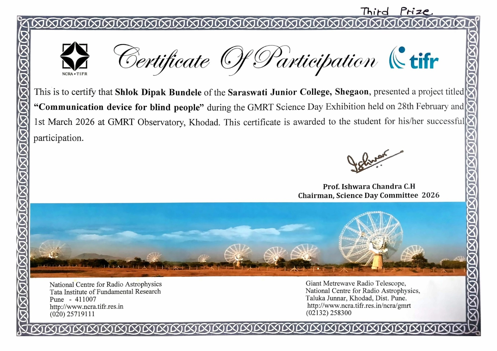

# Braille

Braille is a small Arduino library. It changes text into Braille and Braille back into text. It runs on any Arduino board. Use it to make Braille readers, keyboards, and displays.

## About

I like to work on devices and technology that help physically disabled people. The reason is personal. My father is one of them.

In February to March 2026, I presented a project based on this idea at the **Giant Metrewave Radio Telescope (GMRT), Pune**, and won **third prize**.



This project is new, and contributors are warmly welcome. For any question, reach me at **official@nirvanatechnologies.in**.

## Braille cell

One cell has six dots:

```
1 4
2 5
3 6
```

The library stores a cell in one byte. Bit 0 to bit 5 are dot 1 to dot 6.

## Install

- In the Arduino IDE, open the **Library Manager**, search for **Braille**, and click **Install**.
- Or download this repo as a ZIP and add it with **Sketch → Include Library → Add .ZIP Library**.

Then add it to a sketch:

```cpp
#include <Braille.h>
```

## API

| Function | What it does |
|---|---|
| `encode(char c)` | One character to one cell. Space and unknown give an empty cell. |
| `decode(uint8_t cell)` | One cell to one character. Empty cell gives space. Unknown gives 0. |
| `dot(uint8_t cell, uint8_t n)` | True if dot `n` (1..6) is raised. |
| `capitalSign()` | The cell shown before a capital letter. |
| `numberSign()` | The cell shown before a number. |
| `textToCells(text, cells, maxCells)` | Turn text into cells, adding capital and number signs. Returns the count. |

## Examples

| Example | What it shows |
|---|---|
| `TextToBraille` | Print letters as 6-dot cells on the Serial Monitor. |
| `BrailleToText` | A 6-key Braille keyboard. Read the keys, print the letter. |
| `BrailleLinearActuator` | Drive one cell of six actuators, one per dot. |
| `VibrationBraille` | Buzz each letter on one vibration motor. |

## License

Apache 2.0. See [LICENSE](LICENSE).
